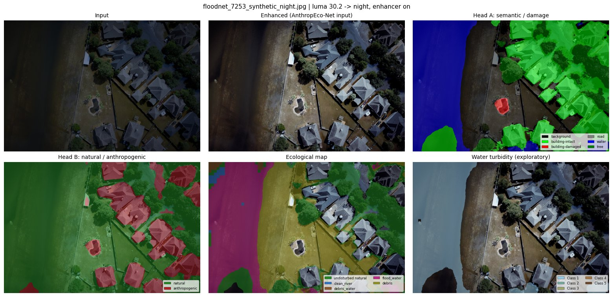

# A Unified Single-Pass Framework for Day-and-Night Anthropogenic and Ecological Disaster Impact Assessment from UAV Imagery

Inference demo of the paper. A luminance rule routes each UAV image as day or night; night images are
brightened by a small task-trained enhancer; then **AnthropEco-Net** maps anthropogenic damage (Head A)
and the natural / anthropogenic partition (Head B) in one pass, and gates an ecological expert that maps
flood water, debris and (exploratory) water turbidity on the natural part of the scene.

> This repository contains an inference-only demo. The full training and evaluation code is available
> from the authors upon request.

```
image ─► luminance rule (τ = 84) ─┬─ day ───────────────────────┐
                                  └─ night ─► enhancer (DCE-Net) ┴─► Block B: AnthropEco-Net + ecological expert
                                                                     ─► Head A map, ecological map, turbidity map
```

AnthropEco-Net is described in detail, from the code, in **[docs/ANTHROPECONET.md](docs/ANTHROPECONET.md)**.

## Installation

Python 3.11. With pip (CPU-only PyTorch shown; use the CUDA wheels to run on a GPU):

```bash
python -m venv .venv && source .venv/bin/activate
pip install torch==2.5.1 torchvision==0.20.1 --index-url https://download.pytorch.org/whl/cpu
pip install -r requirements.txt
```

With conda:

```bash
conda create -n anthropeco python=3.11 -y && conda activate anthropeco
pip install torch==2.5.1 torchvision==0.20.1 --index-url https://download.pytorch.org/whl/cpu
pip install -r requirements.txt
```

## Weights

The demo needs four checkpoints (189 MB in total) in `weights/`. The download link will be added soon;
then:

```bash
python weights/download_weights.py
```

File names, sizes and SHA-256 checksums are listed in [weights/README.md](weights/README.md).

## Two-minute demo

```bash
python demo.py examples/images --device cpu
```

Expected console output (about 2 minutes and 3 GB of RAM in total on an Intel Xeon Gold 6126 CPU,
24 threads; the timings will differ on your machine):

```
[load] models on cpu in 1.5 s

floodnet_11483.jpg  4000x3000
  luma256 = 110.7  (tau = 84)  -> routed: day, enhancer not applied
  Head A : background 59.5%, building-intact 5.2%, road 3.5%, water 24.3%, tree 7.5%
  Head B : natural 92.2%, anthropogenic 7.8%
  eco    : undisturbed natural 10.1%, clean_river 20.2%, debris_water 0.0%, flood_water 4.2%, debris 57.7% (rest: not natural)
  turbidity (exploratory): 2803361 water px scored, Class 1 77.2%, Class 3 22.7%, Class 5 0.1%
  time   : 21.32 s
  saved  : outputs/floodnet_11483/

floodnet_7253.jpg  4592x3072
  luma256 = 110.6  (tau = 84)  -> routed: day, enhancer not applied
  Head A : background 28.6%, building-intact 28.6%, building-damaged 0.8%, road 0.0%, water 30.9%, tree 11.1%
  Head B : natural 76.0%, anthropogenic 24.0%
  eco    : undisturbed natural 19.2%, clean_river 9.4%, debris_water 0.3%, flood_water 19.8%, debris 27.2% (rest: not natural)
  turbidity (exploratory): 4198482 water px scored, Class 1 5.8%, Class 2 9.3%, Class 3 1.7%, Class 4 83.2%, Class 5 0.0%
  time   : 24.55 s
  saved  : outputs/floodnet_7253/

floodnet_7253_synthetic_night.jpg  4592x3072
  luma256 = 30.2  (tau = 84)  -> routed: night, enhancer applied
  Head A : background 30.8%, building-intact 34.3%, building-damaged 0.7%, water 25.1%, tree 9.1%
  Head B : natural 77.1%, anthropogenic 22.9%
  eco    : undisturbed natural 22.2%, clean_river 0.6%, debris_water 1.4%, flood_water 23.3%, debris 29.5% (rest: not natural)
  turbidity (exploratory): 3532872 water px scored, Class 1 100.0%
  time   : 33.00 s
  saved  : outputs/floodnet_7253_synthetic_night/
```

For each image, `outputs/<image>/` contains:

| File | Content |
|---|---|
| `head_a.png` | Head A class indices: 0 background, 1 building-intact, 2 building-damaged, 3 road, 4 water, 5 tree |
| `head_b.png` | Head B: 0 natural, 1 anthropogenic |
| `eco.png` | ecological map: 0 undisturbed natural, 1 clean_river, 2 debris_water, 3 flood_water, 4 debris, 255 not natural |
| `turbidity.png` | turbidity level 0–4 (Class 1–5) on water, 255 not scored (exploratory) |
| `*_overlay.jpg` | colour overlays of the four maps on the image AnthropEco-Net saw |
| `enhanced.jpg` | the enhanced image (night images only) |
| `panel.png` | all of the above in one figure |

Options: `--no-enhancer` sends night images straight to AnthropEco-Net (to compare with and without
conditioning), `--device cuda` runs on a GPU, `--tau` changes the day/night threshold, and
`--enhancer-tile 0` enhances the whole image in one pass instead of in 1024-px tiles (the tiles overlap
by 16 px, more than the enhancer's 7-px receptive field, so the output is the same up to floating-point
rounding and bit-identical on the example images; the one-pass mode needs about 20 GB of RAM for a
14-megapixel image on CPU).

Example panel (synthetic night version of FloodNet image 7253, routed to night and enhanced):



## Check the installation

```bash
python -m pytest tests/test_demo.py -s
```

The test runs the demo on CPU and compares its four maps with `examples/expected/`, which were produced
by the full research code on the same images.

## Datasets

The models were trained and evaluated on the following datasets, which are **not redistributed** here
(apart from the FloodNet example images in `examples/`, see [examples/README.md](examples/README.md)):

- **RescueNet** (CC BY-NC-ND 4.0): <https://github.com/BinaLab/RescueNet-A-High-Resolution-Post-Disaster-UAV-Dataset-for-Semantic-Segmentation>
- **FloodNet** (CDLA-Permissive 1.0): <https://github.com/BinaLab/FloodNet-Supervised_v1.0>


## Licence

Code: MIT (see [LICENSE](LICENSE)). Example images: CDLA-Permissive 1.0 (FloodNet). Weights: see
[weights/README.md](weights/README.md).
