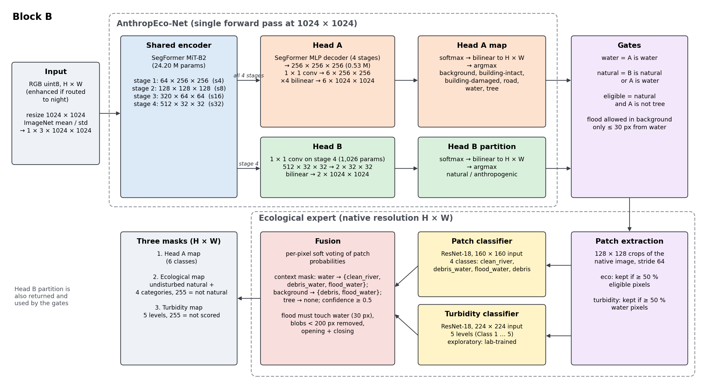
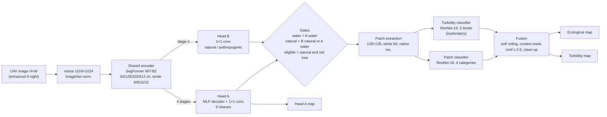

# AnthropEco-Net

This page describes AnthropEco-Net and its ecological expert, which together form **Block B** of the
day-and-night pipeline, as implemented in this repository. Every number is taken from the code, a
checkpoint or a training / benchmark log; values that could not be traced are marked `TODO`.

*Figure: Block B at a 1024 × 1024 network input (batch 1). H × W is the native image size.
Source: [`figures/make_arch_figure.py`](figures/make_arch_figure.py) (SVG: [`figures/anthropeconet.svg`](figures/anthropeconet.svg)).*

## 1. Overview

AnthropEco-Net reads one UAV image and produces, in a single forward pass of one shared encoder, an
anthropogenic damage map (Head A) and a natural / anthropogenic partition (Head B). The two maps then
gate a lightweight **ecological expert** that looks only at the natural part of the scene. Block B
returns three masks at the image's native resolution:

1. the **Head A map**: background, building-intact, building-damaged, road, water, tree;
2. the **ecological map**: on natural pixels, undisturbed natural, clean river, debris in water, flood
   water or debris (255 = not natural);
3. the **turbidity map**: five turbidity levels on scored water pixels (255 = not scored), exploratory.

For a response team, the Head A map locates damaged buildings and blocked access, while the ecological
and turbidity maps flag where the natural environment is affected (flood water outside the river bed,
debris on land or in water), from the same flight and in the same pass. At night, a luminance rule routes
dark images through a small enhancer before Block B (see the main README); Block B itself is unchanged.

## 2. Input and preprocessing

- Input: RGB uint8 image of any size H × W ([`src/anthropeconet/pipeline.py`](../src/anthropeconet/pipeline.py)).
  Night images (mean BT.601 luma of a 256-px downsample < 84) are first enhanced at native resolution
  and quantised back to uint8.
- AnthropEco-Net input: albumentations `Resize(1024, 1024)` (bilinear, aspect ratio not kept),
  `Normalize(mean=(0.485, 0.456, 0.406), std=(0.229, 0.224, 0.225))`, tensor 1 × 3 × 1024 × 1024.
- No test-time augmentation.
- The ecological expert works on the native-resolution image (not the 1024 resize); the Head A / Head B
  probabilities are resized back to H × W (bilinear) before the argmax.

## 3. Shared encoder (SegFormer MiT-B2)

`segmentation_models_pytorch.Segformer(encoder_name="mit_b2")` (smp 0.5.0), initialised from ImageNet
for training (`encoder_weights="imagenet"`; the demo loads all weights from the AnthropEco-Net checkpoint).

| Stage | Output at 1024 × 1024 input | Stride |
|---|---|---|
| 1 | 64 × 256 × 256 | 4 |
| 2 | 128 × 128 × 128 | 8 |
| 3 | 320 × 64 × 64 | 16 |
| 4 | 512 × 32 × 32 | 32 |

Encoder parameters: 24,196,288. Sharing one encoder between the two heads means one forward pass serves
both tasks, and Head B costs almost nothing on top of Head A (Section 9). Training details
(training script not distributed here): RescueNet train split (3,595 images; 449 validation
images), random crops of 736 px after `LongestMaxSize(1600)` and random scaling ×0.5–2.0, flips and
90° rotations, light colour jitter; AdamW, learning rate 1e-4, weight decay 1e-4, batch 4 (2 GPUs),
100 epochs, learning rate decayed to ~0 at the last epoch (`metrics.csv`). The released checkpoint is
epoch 99, validation Head A mIoU 0.7847 and Head B mIoU 0.8792 (at 1024 × 1024, `metrics.csv`).

## 4. Head A: anthropogenic damage

- Decoder: the SegFormer all-MLP decoder of smp, fusing the four encoder stages into a
  256 × 256 × 256 feature map (525,824 parameters), followed by a 1 × 1 convolution 256 → 6
  (1,542 parameters) and ×4 bilinear upsampling to 6 × 1024 × 1024.
- Classes: 0 background, 1 building-intact, 2 building-damaged (all RescueNet damage levels merged),
  3 road (clear and blocked), 4 water, 5 tree. RescueNet vehicle and pool are mapped to background.
- Training loss: cross-entropy weighted by median-frequency class weights
  (background 0.39, building-intact 2.52, building-damaged 1.11, road 0.72, water 0.86, tree 0.39,
  computed on the training split, `damage_weights_median.json`) **plus Dice loss**. The launch script
  used for this checkpoint also passes `--focal`, which **adds a focal loss term** (smp `FocalLoss`,
  default parameters) to Head A. See "Code vs paper" below.

## 5. Head B: natural / anthropogenic partition

- Architecture: a single 1 × 1 convolution 512 → 2 on encoder stage 4 (512 × 32 × 32), i.e. 1,026
  parameters, then bilinear upsampling to 2 × 1024 × 1024.
- Classes: 0 natural (RescueNet background, water, tree), 1 anthropogenic (buildings, road, vehicle, pool).
- Loss: unweighted cross-entropy, weight **0.5** in the total loss
  (`L = L_A + 0.5 · L_B`, `--macro-weight 0.5`).
- Role: Head B is the domain gate of the ecological expert: it decides which part of the scene is
  natural and therefore analysed by the expert (Section 6).

## 6. Gating

From the native-resolution argmax maps ([`experts.py`](../src/anthropeconet/experts.py), `process_image`):

- **water** = Head A predicts water;
- **natural** = Head B predicts natural **or** Head A predicts water (the OR keeps flood water that
  Head B calls anthropogenic, e.g. flooded streets);
- **eligible** = natural **and** Head A is not tree (trees are never re-classified).

The context of each pixel comes from Head A and limits the categories it can receive:

| Head A context | Allowed ecological categories |
|---|---|
| water | clean_river, debris_water, flood_water |
| background | debris, flood_water (flood_water only within 30 px of a dilated Head A water mask; elsewhere debris only) |
| tree | none |

Other natural pixels keep the label "undisturbed natural"; non-natural pixels are 255. The turbidity
classifier is gated by the Head A water mask only.

## 7. Ecological expert

Patches are 128 × 128 crops of the native image on a regular grid with stride 64 (the last row and column
are aligned to the image border). A patch is classified only if at least 50 % of its pixels are eligible
(ecological classifier) or water (turbidity classifier). Each patch is resized bilinearly to the
classifier input size and ImageNet-normalised.

**Patch classifier.** torchvision ResNet-18 with a linear layer 512 → 4 (11,178,564 parameters), input
160 × 160. Categories: clean_river, debris_water, flood_water, debris. Training data: 1,856 labelled
128-px patches (`patches_split.csv`): 1,392 from RescueNet (debris 486, debris_water 466,
clean_river 335, flood_water 105) and 464 from FloodNet (flood_water 361, clean_river 103), split by
source image (train 1,275 / val 345 / test 236). Strong appearance augmentation and a
domain-adversarial head (gradient reversal on a RescueNet / FloodNet discriminator, λ ramped up to 0.5, the script default)
reduce the dataset shortcut; the domain head is dropped at inference. Best epoch 42 of 60; test accuracy
0.962 (RescueNet patches 0.949, FloodNet patches 1.000), `test_metrics.json`.

**Turbidity classifier.** torchvision ResNet-18 with a linear layer 512 → 5 (11,179,077 parameters),
input 224 × 224, levels "Class 1" … "Class 5" (low → high turbidity). Training data: 11,518
**laboratory close-up images of water samples** (e.g. 500 × 500 px; 1,581 / 2,699 / 2,788 / 2,855 /
1,595 per level), split 70 / 15 / 15 %, colour-preserving augmentation only. Dataset source and licence:
`TODO`. Best epoch 39 of 40; test accuracy 0.997 on 1,729 lab images.
**There are no aerial turbidity labels: on UAV imagery the turbidity map is exploratory and is not a
measured quantity.**

## 8. Fusion

([`experts.py`](../src/anthropeconet/experts.py), `process_image` and `postprocess_eco_map`; defaults in `GRID_DEFAULTS`)

1. **Soft voting.** Each classified patch adds its softmax probabilities to every eligible (or water)
   pixel it covers; the per-pixel average is used.
2. **Context mask and confidence.** Probabilities are restricted to the categories allowed by the pixel's
   context (Section 6) and renormalised; the pixel takes the arg-max category if its normalised
   probability is ≥ 0.5, otherwise it stays "undisturbed natural".
3. **Clean-up of the ecological map.**
   - a flood_water region must touch the Head A water mask dilated by 30 px, otherwise it becomes
     undisturbed natural;
   - disturbed regions (debris_water, flood_water, debris) smaller than 200 px are removed;
   - per disturbed category, a binary opening (removes specks) then a closing (fills pinholes, only into
     undisturbed natural pixels).
4. **Turbidity.** Same soft voting on Head A water pixels, confidence ≥ 0.5, no clean-up.

The three output masks are the Head A map, the cleaned ecological map and the turbidity map (Head B is
also returned).

## 9. Parameters and latency

| Part | Parameters | FLOPs at 1024 × 1024 |
|---|---|---|
| Luminance rule | 0 | — |
| Enhancer (DCE-Net) | 79,416 | 166.1 G (conv) |
| AnthropEco-Net: encoder | 24,196,288 | |
| AnthropEco-Net: Head A (decoder + 1 × 1 conv) | 527,366 | |
| AnthropEco-Net: Head B | 1,026 | |
| **AnthropEco-Net total** | **24,724,680** | **294.0 G** |
| Patch classifier | 11,178,564 | |
| Turbidity classifier | 11,179,077 | |
| Experts + fusion (incl. one AnthropEco-Net pass) | | 652 ± 227 G per image |

FLOPs: `torch.utils.flop_counter` (2 × MACs of convolutions and matrix products).

Latency per image at 1024 × 1024 input (batch 1, 20 warm-up + 200 timed images of the synthetic-night
test set, mean ± std):

| Stage | GPU: NVIDIA H200 | CPU: AMD EPYC 9124, 32 threads |
|---|---|---|
| Luminance rule | 1.3 ms | 1.5 ms |
| Enhancer | 5.4 ms | 186.6 ms |
| AnthropEco-Net (forward) | 16.2 ms | 862.5 ms |
| Routing + enhancer + AnthropEco-Net, end to end | 26.3 ms | 1,356 ± 211 ms |
| Ecological expert + fusion (`BlockB.masks`) | 108.7 ± 44.1 ms | 1,581 ± 584 ms |

The expert time depends on the image (number of eligible patches). On full-size FloodNet images
(4000 × 3000 and 4592 × 3072) the whole demo takes 21.3 s and 24.6 s for the two day images and 33.0 s for the night image
(enhancer included), 117 s for the three images with model loading, peak RAM 3.0 GB, on an Intel Xeon
Gold 6126 CPU with 24 threads (see the README).

## 10. Known limitations

- **Turbidity is exploratory**: the classifier is trained on laboratory close-ups and has never been
  validated on aerial water.
- The ecological patch classifier is trained on a small set (1,856 patches, two datasets), and its
  decisions are made at patch granularity (128 px, stride 64), so region borders are blocky. On the demo
  image `floodnet_11483.jpg` it labels most of a mown field as debris.
- AnthropEco-Net sees a square 1024 × 1024 resize of the image: thin structures are lost on large
  frames and the aspect ratio is not preserved.
- Night robustness was measured on synthetic night images (and qualitatively on real night frames
  without ground truth); the luminance rule is a single global threshold (τ = 84) and does not handle
  partly lit scenes specially.
- The training and evaluation data are post-hurricane UAV images (RescueNet, FloodNet); other disaster
  types, sensors or altitudes are untested.
- `TODO`: check this list against the limitations paragraph of the paper.

## Code vs paper

Points where the implementation is more specific than (or differs from) a short description of the method:

1. The expert's gate is (Head B natural **or** Head A water) **and not** Head A tree, not only
   "Head A water and Head B natural".
2. The turbidity classifier is gated by the Head A water mask only.
3. Head A context restricts the categories (water → 3 categories, background → 2, tree → none), and
   flood_water is allowed on background pixels only within 30 px of water.
4. Patches are processed only if ≥ 50 % of their pixels are eligible (or water).
5. "Fusion" includes post-processing: water connectivity of flood (30 px), removal of regions < 200 px,
   opening and closing.
6. The experts run at native resolution, AnthropEco-Net at a 1024 × 1024 resize.
7. Head A loss: median-frequency-weighted cross-entropy + Dice **+ focal loss** (`--focal` in the
   launch script of the released checkpoint; the log of the first training epochs is not available,
   the resumed run's log shows the same launch script).
