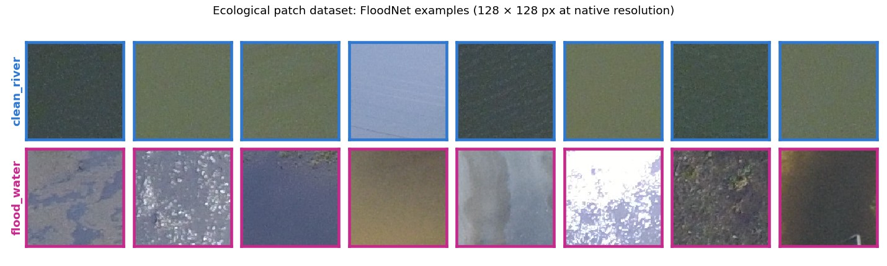
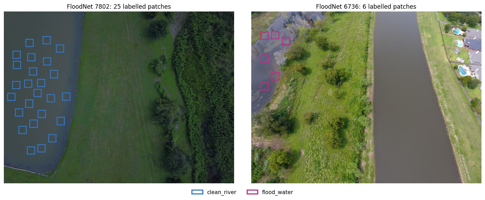

# Ecological patch dataset (examples)

The ecological expert of AnthropEco-Net classifies 128 × 128 patches of natural regions into four
categories. We built a dedicated patch dataset for it from post-hurricane UAV images of RescueNet and
FloodNet. This folder shows **examples from FloodNet only**; the full dataset is not distributed here.

## Categories

| Category | Meaning |
|---|---|
| `clean_river` | water body without visible debris (river, pond, lake) |
| `debris_water` | water carrying floating debris |
| `flood_water` | water outside the normal water bodies (flooded land, yards, roads) |
| `debris` | debris on land |

At inference, the category a pixel can receive depends on its Head A context: water pixels can only
become clean_river, debris_water or flood_water; background pixels debris or flood_water (flood_water
only near water); trees are never re-classified (see [docs/ANTHROPECONET.md](../../docs/ANTHROPECONET.md)).

## How it was built

- **Source images:** training splits only of RescueNet and FloodNet, so the two datasets' test sets stay
  untouched.
- **Labelling:** with a browser-based tool, square boxes were placed by hand on the full-resolution images
  and assigned one of the four categories; each box is cropped **at native resolution** (no resizing) and
  stored with its provenance (dataset, source image, position, size).
- **Split:** at the image level, so that overlapping patches of one scene never fall in different splits,
  stratified by dataset and by the categories an image contains.

## Size

1,856 patches of 128 × 128 px from 109 source images (83 RescueNet, 26 FloodNet).

| Category | RescueNet | FloodNet | Total | Train | Val | Test |
|---|---|---|---|---|---|---|
| clean_river | 335 | 103 | 438 | 271 | 69 | 98 |
| debris_water | 466 | 0 | 466 | 334 | 76 | 56 |
| flood_water | 105 | 361 | 466 | 316 | 112 | 38 |
| debris | 486 | 0 | 486 | 354 | 88 | 44 |
| **Total** | **1,392** | **464** | **1,856** | **1,275** | **345** | **236** |

debris and debris_water occur only in RescueNet, while most flood_water patches come from FloodNet. To
keep the classifier from recognising the dataset rather than the category, it is trained with strong
appearance augmentation and a domain-adversarial head. On the 236 test patches it reaches an accuracy of
0.962 (0.949 on RescueNet patches, 1.000 on FloodNet patches).

## Files here

- `clean_river/`, `flood_water/`: 8 example patches each (PNG, 128 × 128), file name
  `floodnet__<image>__x<left>_y<top>_s<size>.png`, i.e. the crop position in the FloodNet training
  image. They were drawn at random (seed 0) among the FloodNet patches, at most two per source image.
- `patch_grid.jpg`: the 16 example patches.
- `patch_context.jpg`: all labelled boxes of FloodNet training images 7802 and 6736.

The patches and figures are derived from FloodNet (CDLA-Permissive 1.0, see
[`../LICENSE-CDLA-Permissive-1.0.txt`](../LICENSE-CDLA-Permissive-1.0.txt) and the credit in
[`../README.md`](../README.md)). RescueNet patches are not included because RescueNet is released under
CC BY-NC-ND 4.0.
